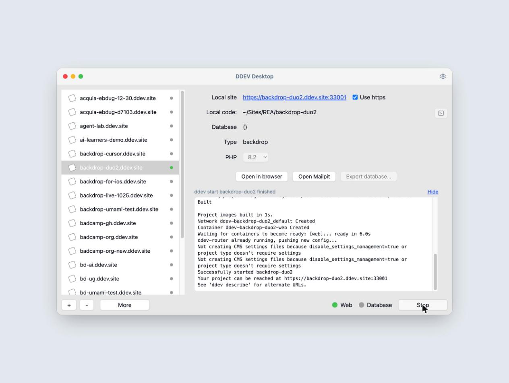
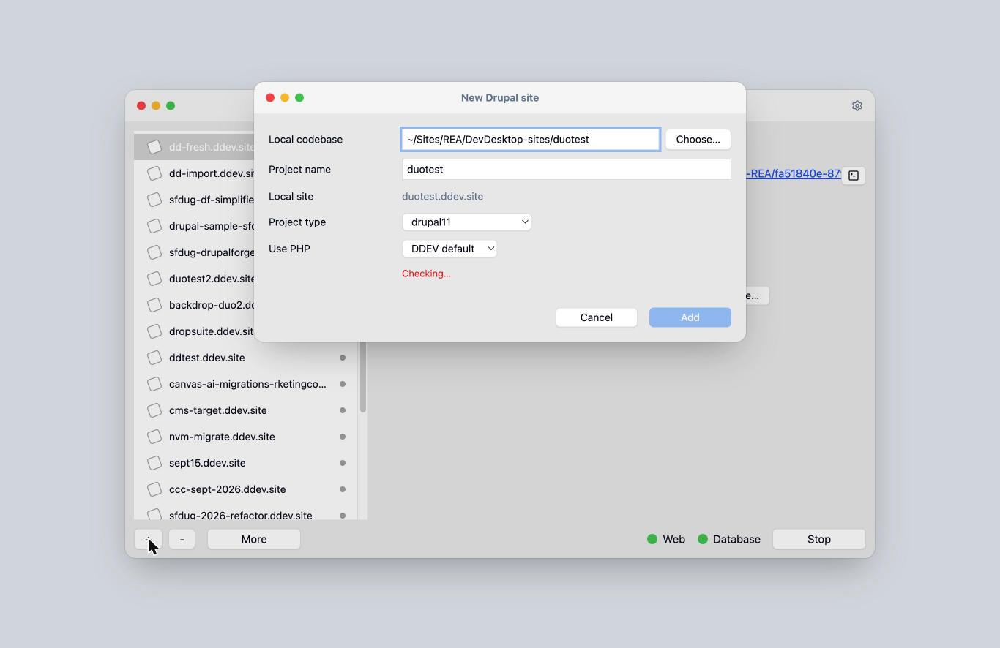
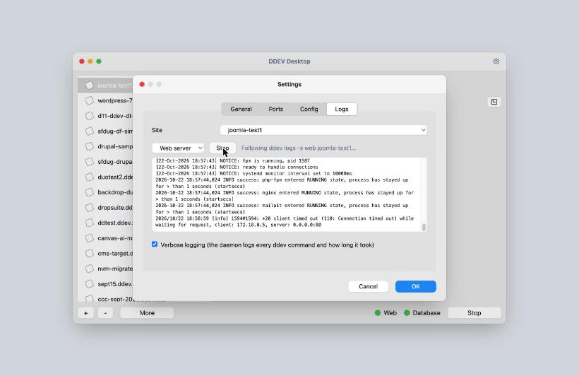
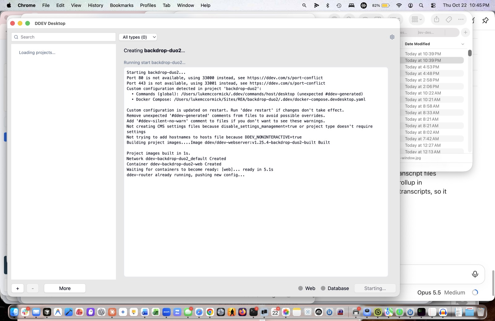

# ddev-desktop

A control panel for your [DDEV](https://ddev.com) projects, in the spirit
of the old Acquia Dev Desktop: sites on the left, the selected site's URL,
code folder, database and PHP version on the right, Start and Stop at the
bottom. It opens in your browser and does everything through the `ddev`
command line, showing you each command's output as it runs.



## Install

You need DDEV 1.23 or newer. From inside any DDEV project:

```
ddev add-on get cellear/ddev-desktop
ddev desktop
```

The add-on installs one host command globally (`~/.ddev/commands/host/desktop`),
so `ddev desktop` works from any directory afterwards. The first run
downloads the daemon binary for your platform (macOS or Linux, Intel or
Apple Silicon) into `~/.ddev-desktop/bin/` from the latest release, then
opens the panel in its own window (Chrome, Brave or Edge in app mode) or,
without one of those, in a browser tab. Press Ctrl-C in that terminal to
quit.

`ddev desktop --update` downloads the latest binary again.

## What it does

- **Lists your projects**, most recently started first, with a live
  status dot; search by name or filter by type to find any of them. Shows
  the selected project's URL, code folder, database, type and PHP version.
- **Start, Stop**, with ddev's output streaming into the panel. Only the
  project you act on is touched; the panel never runs `ddev poweroff`.
- **Change PHP version** from a dropdown; a running project is restarted.
- **Open in browser, Open Mailpit, Export database** (a plain `.sql`
  download), open the code folder in Finder, open a terminal running
  `ddev ssh` (Terminal, iTerm2 or Warp).
- **Import local site…** turns an existing codebase into a DDEV project,
  optionally loading a database dump. Any type DDEV recognises works:
  Drupal, Backdrop, WordPress, Joomla, Laravel, TYPO3 and the rest.
- **New site…** does the same, or builds a fresh codebase in an empty
  folder: Drupal via Composer, WordPress via WP-CLI, Joomla from the
  latest joomla.org release.
- **Remove** a project from DDEV (`ddev delete`), with or without a
  snapshot; the code stays on disk.
- **Settings:** own window or browser tab; terminal app; start the sites that were running when the
  panel last quit; stop the sites the panel started when quitting; DDEV's
  global HTTP/HTTPS ports and TLD; a default PHP version for new sites;
  Edit buttons for a project's `.ddev/config.yaml`, its `php/` and
  `mysql/` folders and the global config; live `ddev logs` for the web and
  database containers.





## Good to know

- **DDEV is the source of truth.** The panel keeps only its own
  preferences in `~/.ddev-desktop/settings.json`. Everything else is read
  from `ddev list`, `ddev describe` and `ddev config global` each time.
- **Twenty at a glance.** The sidebar shows the twenty projects whose
  last `ddev start` is most recent; search, the type filter or "Show all"
  reach the rest.
- **Ports.** The panel uses whatever URLs ddev reports. If another tool
  holds ports 80 and 443, DDEV 1.25 moves its router to other ports and
  the Settings dialog says which.
- **A custom TLD** needs hosts-file entries, which DDEV asks for when you
  run `ddev start` in a terminal. The panel runs ddev without a terminal
  and cannot add them; stick to `ddev.site` or run `ddev start` once by
  hand.
- **Coming from Acquia Dev Desktop?** A copied codebase whose
  `settings.php` still includes Dev Desktop's `loc_*_dd.inc` file imports
  and starts but answers 500 until that include is removed.

## Security

The daemon binds 127.0.0.1 only and refuses any request without a
per-launch token (passed once in the URL, then kept in a cookie) or with a
Host header other than 127.0.0.1 / localhost. Without that, any web page
you visit could run ddev commands through it. It runs ddev with
`DDEV_NONINTERACTIVE=true`, so nothing ever waits for an answer.

## Uninstall

From the project you installed it in: `ddev add-on remove ddev-desktop`.
That removes the command and the downloaded binary; `~/.ddev-desktop/`
keeps your settings until you delete it.

## Development

Requirements: Go 1.25+, Node 22+, DDEV on your PATH.

```
make build          # builds ui/dist, then bin/ddev-desktop
bin/ddev-desktop    # opens http://127.0.0.1:<port>/?token=…
make dist           # four release binaries + checksums.txt in dist/
```

Daemon flags: `--port N` (default: a free port), `--no-open`, `--limit N`
(default 20), `--state-dir DIR` (default `~/.ddev-desktop`, for running a
test instance beside the real one), `--version`. A second instance while
one is running just opens the browser on the running one; its address is
in `~/.ddev-desktop/daemon.json`.

For UI work, start the daemon with `--port 8471 --no-open` and run
`npm run dev` in `ui/`; Vite proxies `/api` to it. Open the Vite URL with
`?token=<token from daemon.json>` once.

To run the add-on command against a local build, set
`DDEV_DESKTOP_BIN=/path/to/bin/ddev-desktop` or put the binary on your
PATH (`make install` copies it to `~/go/bin`). To install the add-on from
the working copy: `ddev add-on get /path/to/ddev-desktop` inside any
project.

Releases: push a tag (`git tag v0.1.0 && git push --tags`); the workflow
builds the page and the four binaries and attaches them to a GitHub
release, which is what `ddev add-on get cellear/ddev-desktop` and the
host command's download use.

## Development process

This repo uses the [agent handoff protocol](https://github.com/cellear/agent-handoff):
`AGENT.md` for the rules, `HANDOFF/` for session journals, `DOC/` for
reference docs and `DOC/sprints/` for sprint plans. The plan and the
lessons from the earlier Dev Desktop experiments are in
`DOC/implementation-plan.md`.
